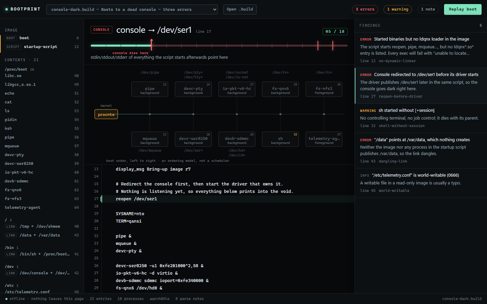

# Bootprint

**Read a QNX system image the way the board will read it — before you flash it.**

A QNX OS image is a text file. `mkifs` turns it into an image; the board turns that image into a running system. When it does not come up, the only diagnostic is a serial console that may itself be dead, because the mistake was redirecting the console to a device whose driver starts four lines later.

Bootprint is a host tool for that afternoon. It parses the buildfile, resolves what the image will contain, replays the boot order, and reports what will fail — each finding pointing at the line to edit.

**[Open it →](https://hkmpn9s6dh-commits.github.io/hackathon-2026-qnx/)** — no install, no account, no network. Everything runs in the page.



---

## What it does

| | |
|---|---|
| **Parse** | The mkifs buildfile grammar: attribute groups, global vs entry-scoped attributes, inline files with `\{` `\}` `\\` escapes, `dest=source` pairs, `[type=link]`, `[+script]`, `[+session]`. |
| **Resolve** | Where every listed file actually lands (`/proc/boot` for bare names), what each symlink points at, which entry wins when two claim the same path. |
| **Replay** | startup → procnto → each script line in order. Background commands spawn; foreground commands block; `waitfor`, `reopen`, `display_msg`, `procmgr_symlink` are modelled as builtins, not processes. |
| **Explain** | Sixteen rules, each traced to a documented QNX behaviour, each with the line number and a concrete fix. |
| **Fix** | The source stays editable. Analysis re-runs on every keystroke; the finding disappears when the mistake does. |

The replay is the point. "What is alive when line 17 runs" is the question a boot hang asks, and it is a question you can answer by scrubbing a timeline instead of flashing a board.

## Quick start

```bash
npm ci
npm run dev        # http://localhost:5173
npm test           # 15 unit tests
npm run build      # static bundle in dist/
```

Or open the deployed page and drag a `.build` file onto it.

## The rules

| Rule | Severity | What it catches |
|---|---|---|
| `no-boot-image` | error | Nothing carries `[virtual=…]` with a boot script |
| `boot-without-startup` | error | Boot script never runs a `startup-*` binary |
| `boot-without-procnto` | error | Boot script never starts the kernel |
| `boot-without-path` | warning | `PATH` not set before `procnto` |
| `no-startup-script` | warning | No `[+script]` entry, so nothing ever starts |
| `no-dynamic-linker` | error | Binaries are started but no `ldqnx*.so*` is in the image |
| `no-libc` | warning | No `libc.so` in the image |
| `dangling-link` | error | `[type=link]` target that nothing creates |
| `duplicate-target` | warning | Two entries claim the same path; the last one wins silently |
| `link-with-contents` | error | A symlink that also carries an inline body |
| `reopen-before-driver` | error | Console redirected before the driver that creates the device |
| `foreground-blocks-boot` | warning | A daemon started without `&`, so the script never continues |
| `shell-without-session` | warning | Interactive shell started without `[+session]` |
| `device-never-provided` | warning | A process handed a `/dev` path nothing in the image creates |
| `linker-width-mismatch` | warning | 32-bit loader in a 64-bit image, or the reverse |
| `world-writable` | info | A writable file in an otherwise read-only image |

Every rule is tested both ways: it fires on a fixture that has the mistake, and it stays silent on the clean image.

## Evidence of QNX use

This is a *host* tool in the **Developer Tooling & Host Tools** category. The QNX connection is in the artefact:

- **`src/core/parse.ts`** implements mkifs buildfile semantics — attribute persistence across entries, entry-scoped groups, `/proc/boot` placement for bare names, inline-file escapes, `dest=source`.
- **`src/core/devices.ts`** encodes what QNX components publish: `procnto` owns `/dev/shmem`, `/dev/null`, `/dev/zero`; `devc-ser*` creates `/dev/ser*`; `devb-*` creates block devices; `io-pkt`/`io-sock` create `/dev/socket`.
- **`src/data/samples/`** carries real buildfiles, including `s-core-init.build` from the Eclipse s-core reference integration (Apache-2.0, header preserved) — running Bootprint on it finds a symlink (`/data` → `/tmp_ram`) that points at a node nothing creates.
- **`docs/02-GRAMMAR.md`** documents the implemented grammar subset with the QNX documentation page for each construct, and names what is deliberately not implemented.

**QNX version:** the tool reads buildfiles as documented for **QNX SDP 8.0** (the samples target `x86_64`, `aarch64le` and `armle-v7`).
**Target:** host only — Windows, macOS or Linux. No QNX target, licence or QEMU is required to run it.
**Toolchain:** Node.js 20+ and npm to build; the deployed artefact is a static bundle with no runtime dependency.

## What it does not do

- It does not build images or call `mkifs`. It reads the same input `mkifs` reads.
- It does not simulate scheduling, timing or priority inversion. It models **boot order**, and the UI says so.
- It does not phone home. There is no server, no account and no telemetry; `scripts/e2e.mjs` asserts that the page makes zero third-party requests.

## Repository layout

```
src/core/      parser, resolver, boot replay, rule engine   (pure TypeScript, no DOM)
src/ui/        the five panes of the one screen
src/data/      real and synthetic .build fixtures
docs/          00-BRIEF · 01-SPEC (acceptance criteria) · 02-GRAMMAR · 04-PROOF · 07-UI
scripts/       verify.sh · e2e.mjs · bench.mjs · demo.mjs · deploy.sh
proof/         screenshots, measurements, blind-ranking record
```

## Licence

MIT. `src/data/samples/s-core-init.build` is Apache-2.0, © Eclipse Foundation, reproduced with its header.
